# Auditor de políticas de seguridad contra NIST CSF 2.0

## 1. Resumen

Este informe describe el diseño y la construcción de un producto inteligente que audita políticas y
procedimientos de seguridad de la información contra los controles del **NIST SP 800-53 Rev. 5** y presenta
los hallazgos organizados por las seis funciones del **NIST CSF 2.0**. El producto recibe un documento y
entrega un informe de brechas con el estado de cada control, su gravedad, la evidencia citada y una
redacción corregida; no es un chatbot. El servicio implementa una arquitectura en capas con las capas
obligatorias de una aplicación de IA en producción —construcción de contexto con RAG, guardrails,
enrutador y gateway de modelos, caché, orquestación con ciclo de agente, observabilidad y
retroalimentación— y se expone como una API REST consumida por una aplicación web. Todo se ejecuta de forma
local sobre modelos servidos con Ollama.

## 2. La idea del producto (ficha)

| Elemento | Descripción |
|---|---|
| Nombre del producto | Auditor de políticas de seguridad contra NIST CSF 2.0 |
| Usuario y contexto de uso | Responsable de seguridad de la información de una organización de infraestructura crítica, al revisar si sus políticas y procedimientos cubren un marco de control reconocido |
| Problema que resuelve | Comparar un documento interno contra cientos de controles es lento y propenso a omisiones; exige experiencia y tiempo |
| Resultado que entrega | Un informe de brechas por función del CSF 2.0: por cada control relevante, su estado (cubierto / parcial / ausente), gravedad, evidencia textual, control citado y redacción corregida. No es una conversación |
| Tipo de producto | Combinación de auditor de documentos, clasificador/priorizador y generador fundamentado |
| Cómo intervienen modelos, embeddings y RAG | Los embeddings indexan el catálogo de controles; el RAG recupera, por sección, los controles pertinentes; el modelo determina cobertura, gravedad y redacción corregida citando la fuente recuperada |
| Qué lo hace original | Cambia el resultado (de responder a emitir un informe estructurado accionable) y combina tres tipos de producto; aplica a un problema local y real de cumplimiento |
| Cómo se medirá su valor | Acierto@k de la recuperación, fidelidad al contexto con y sin RAG, porcentaje de brechas correctamente identificadas sobre un conjunto de prueba, y reducción de tiempo frente a la revisión manual |

La función principal entrega un artefacto (el informe) dentro del flujo de trabajo del usuario; la
conversación sobre los controles es una función secundaria (endpoint `/preguntas`).

## 3. Dominio del problema y corpus

El dominio es el cumplimiento de controles de seguridad en infraestructura crítica. La base de conocimiento
es el catálogo **NIST SP 800-53 Rev. 5**, obtenido en formato OSCAL del repositorio oficial
`usnistgov/oscal-content`. Es de dominio público (obra del gobierno de EE. UU., con dedicación CC0 1.0). El
script `scripts/construir_corpus_80053.py` extrae el enunciado y la guía de cada control base —se omiten las
mejoras de control para mantener el corpus enfocado— y genera un documento Markdown por control, con la
familia y la función del CSF 2.0 asociada. El corpus resultante es de **301 controles** (≈1.3 MB), lo que
supera el mínimo sugerido de 20 documentos o 50 páginas. Los documentos que se auditan en la demostración y
en la evaluación son políticas ficticias creadas para el proyecto, sin datos personales reales (ver
`corpus/LICENCIAS.md`).

El corpus está en inglés y los documentos a auditar en español, por lo que el modelo de embeddings debe ser
multilingüe; esto se aborda en la selección de modelos (sección 7) y en el ADR-01.

## 4. Requisitos y atributos de calidad

**Requisitos funcionales:** cargar un documento (PDF, DOCX, Markdown o texto); auditar por secciones contra
el corpus; emitir un informe con estado, gravedad, evidencia, control citado y recomendación; agrupar por
función del CSF; registrar retroalimentación; exponer métricas; responder consultas puntuales con fuentes.

**Atributos de calidad priorizados y medibles:**

| Atributo | Métrica | Meta orientativa |
|---|---|---|
| Exactitud de recuperación | acierto@3 (nivel familia de control) | ≥ 0.80 |
| Fidelidad al contexto | puntaje de juez 0–5, con y sin RAG | con RAG ≥ 4, y > sin RAG |
| Privacidad | datos personales en claro enviados o devueltos | 0 |
| Seguridad | bloqueos correctos de inyección | 100 % de las entradas problemáticas |
| Latencia | tiempo por consulta en el equipo local | < 2 min por sección (ruta compleja) |
| Uso de recursos | RAM del modelo activo | dentro de 32 GB |

Los valores medidos se reportan en la sección 10.

## 5. Arquitectura

El sistema tiene dos contenedores: la aplicación web (capa de presentación) y el servicio (lógica de
negocio). Dentro del servicio, el código se organiza en capas; cada capa solo usa a las de abajo por
interfaces, y las dos capas transversales (observabilidad y retroalimentación) pueden ser usadas por todas.
La elección de los adaptadores concretos (Ollama o simulado, Chroma o memoria) ocurre en un único lugar, la
raíz de composición (`servicio/contenedor.py`), de modo que las capas superiores dependen solo de
interfaces (`servicio/datos/interfaces.py`).

**Figura 1. Diagrama de contexto.**

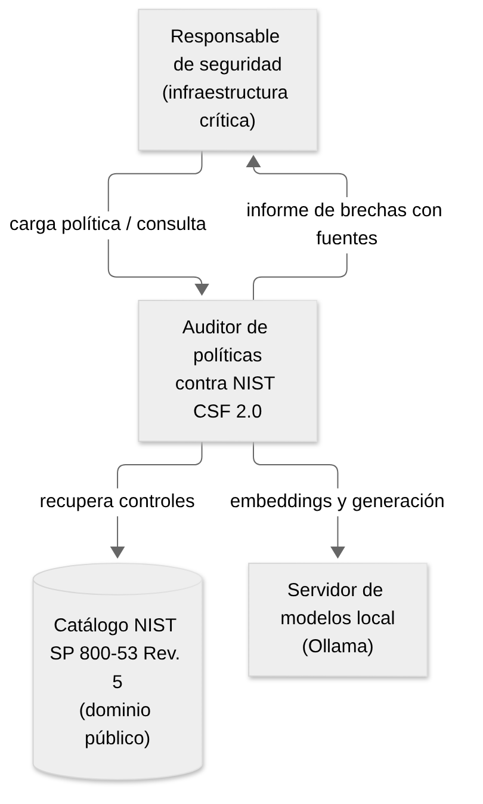

**Figura 2. Diagrama de contenedores.**

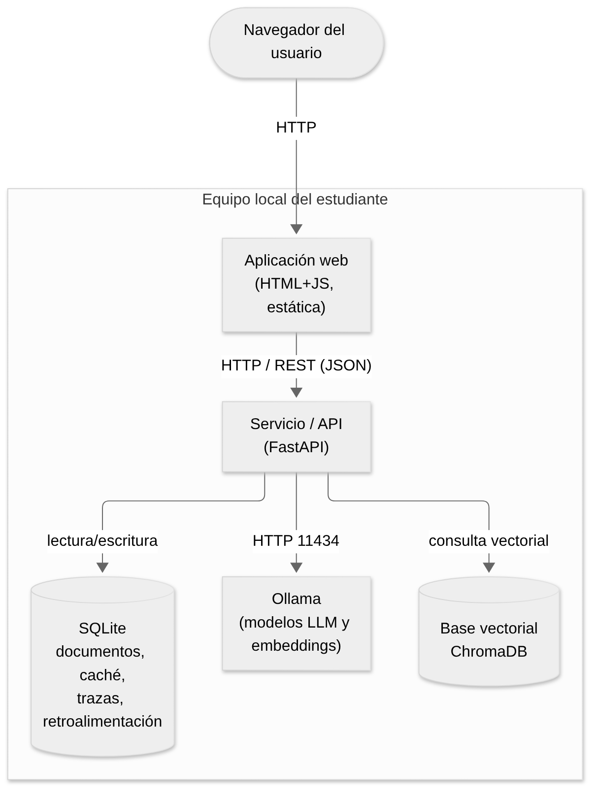

**Figura 3. Capas del servicio y dirección de dependencias.**

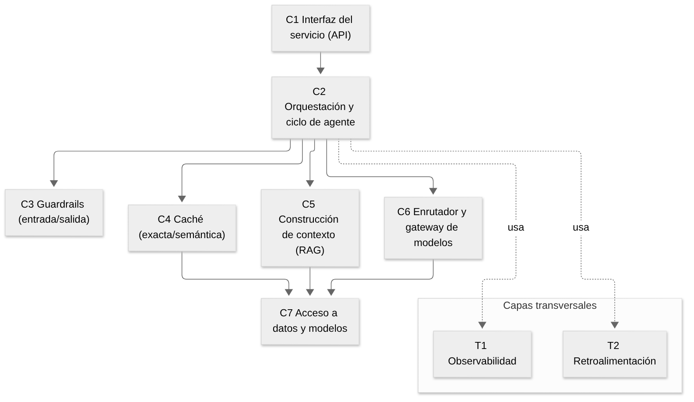

**Figura 4. Componentes principales por capa.**

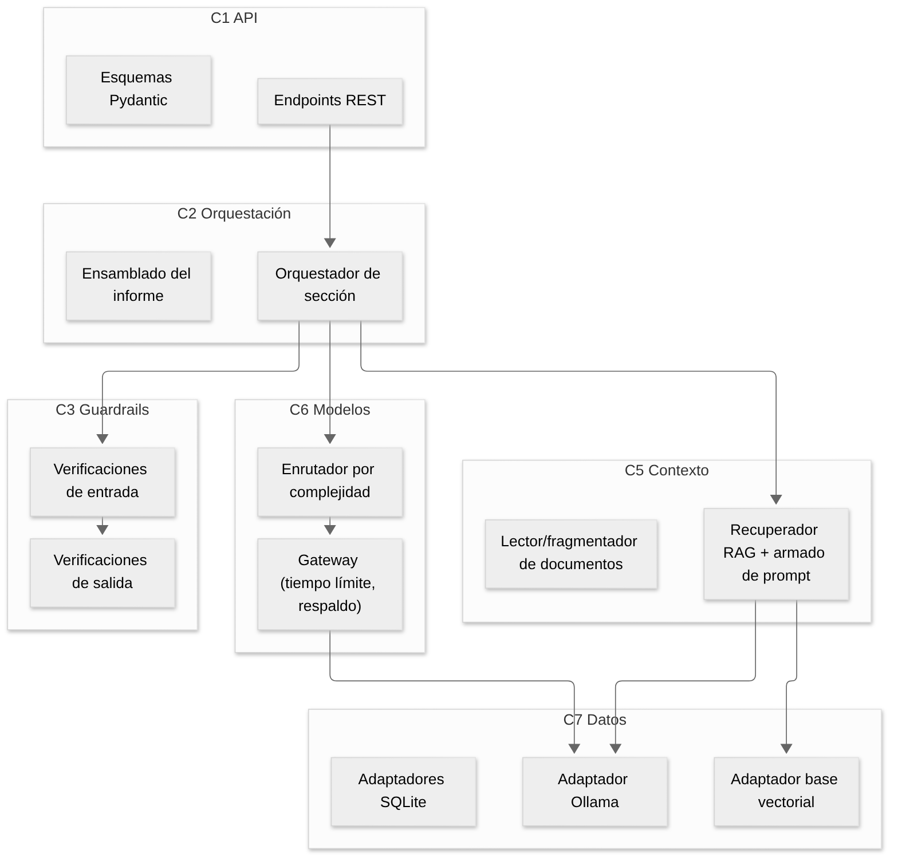

**Figura 5. Despliegue local.**

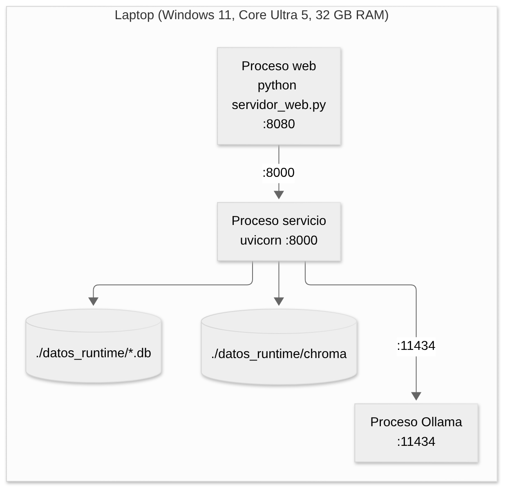

Responsabilidad e interfaz de cada capa:

| Capa | Responsabilidad | Interfaz principal |
|---|---|---|
| C1 Interfaz del servicio | Recibe HTTP, valida entrada/salida, traduce a llamadas de orquestación; sin lógica de IA | `servicio/api/app.py` (FastAPI) |
| C2 Orquestación y agente | Coordina el flujo de cada consulta; implementa el ciclo de agente | `Orquestador.analizar_seccion` |
| C3 Guardrails | Verificaciones de entrada y salida con política por falla | `verificar_entrada`, `verificar_salida` |
| C4 Caché | Caché exacta y semántica con invalidación y expiración | `CacheConsultas.buscar/guardar` |
| C5 Construcción de contexto | Lectura y fragmentación, RAG, armado del prompt | `ConstructorContexto` |
| C6 Enrutador y gateway | Clasifica la consulta y ofrece interfaz única a los modelos con tiempo límite y respaldo | `Enrutador`, `GatewayModelos` |
| C7 Acceso a datos y modelos | Adaptadores a Ollama, base vectorial y SQLite | interfaces en `datos/interfaces.py` |
| T1 Observabilidad | Traza por consulta, bitácoras por capa, métricas | `observador` |
| T2 Retroalimentación | Opinión del usuario ligada a la traza | `ServicioRetroalimentacion` |

## 6. Comportamiento

El flujo de una consulta sigue los pasos de la sección 4.2 del enunciado. Se documentan cinco escenarios.

**Figura 6. Secuencia: ingesta de un documento.**

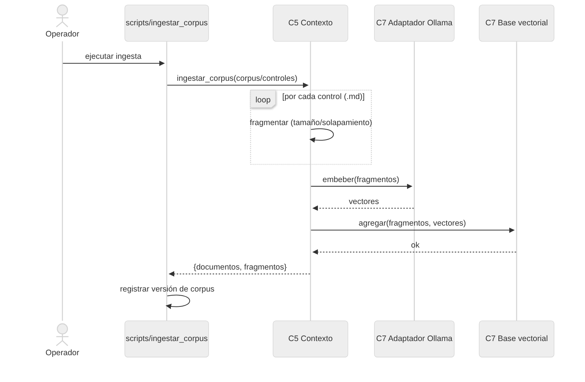

**Figura 7. Secuencia: consulta normal (recorrido completo por las capas).**

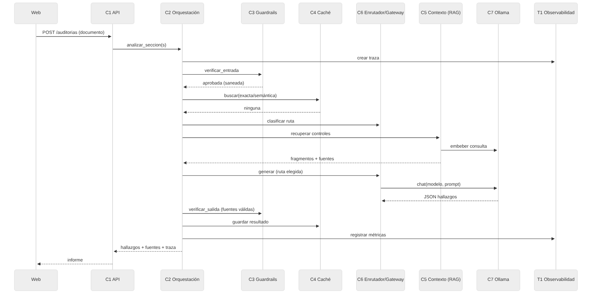

**Figura 8. Secuencia: respuesta desde la caché semántica.**

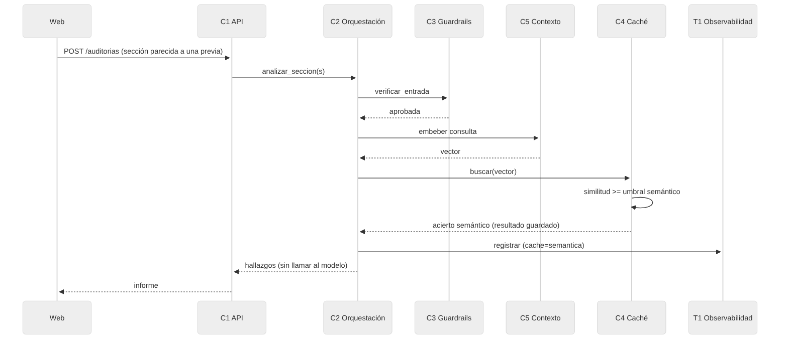

**Figura 9. Secuencia: consulta bloqueada por los guardrails.**

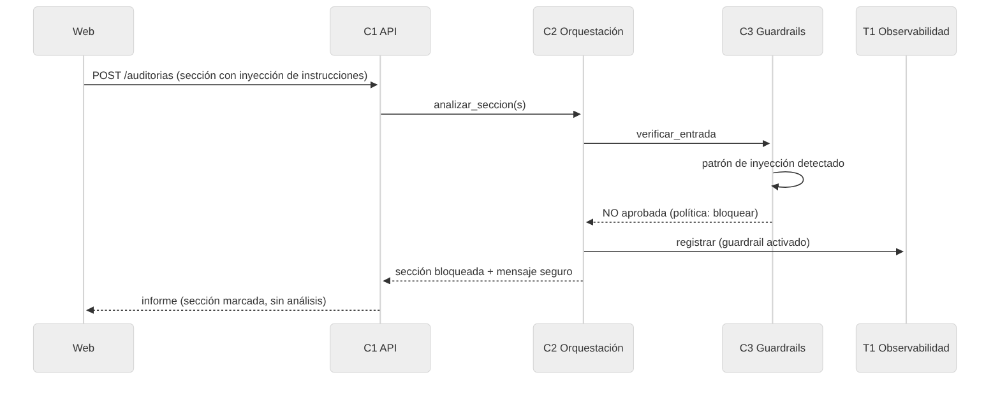

**Figura 10. Secuencia: ciclo de agente ante recuperación pobre.**

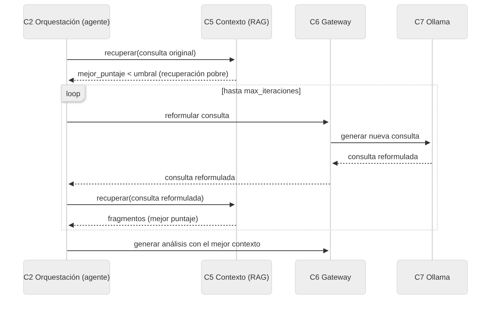

## 7. Selección de modelos y enrutamiento

Se compararon al menos dos modelos de lenguaje y dos de embeddings sobre el mismo corpus y las mismas
preguntas de prueba (`evaluacion/experimento_embeddings.py` y `experimento_modelos.py`). El experimento de
embeddings mide acierto@k a nivel familia de control sobre 22 casos de prueba; el de modelos mide latencia,
tokens de salida, validez del esquema JSON y fidelidad según un modelo juez, sobre el mismo contexto
recuperado.

**Modelos de embeddings comparados:** `nomic-embed-text`, `bge-m3` y `mxbai-embed-large`.
**Modelos de lenguaje comparados:** `qwen2.5:3b`, `llama3.2:3b` y `qwen2.5:7b`.

Resultados del experimento (se completan con la corrida local):

> `[[TABLA_EMBEDDINGS]]`

**Figura 11. Recuperación por modelo de embeddings.**

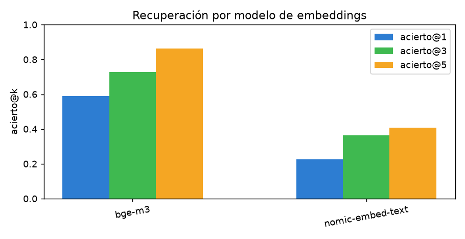

> `[[TABLA_MODELOS]]`

**Figura 12. Modelos de lenguaje: latencia frente a fidelidad.**

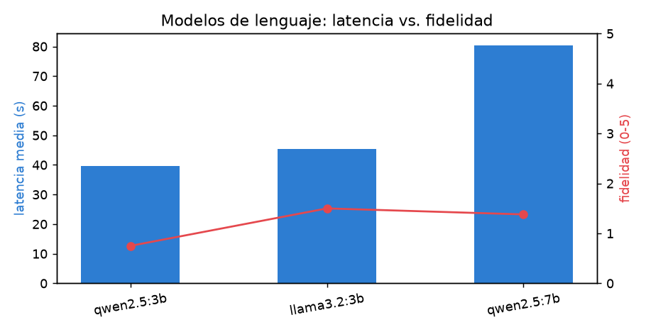

**Criterio del enrutador.** El resultado alimenta directamente al enrutador (C6): el modelo pequeño y
rápido atiende la ruta simple y el más capaz la ruta compleja. La sección se clasifica por un criterio
explícito y barato (temas de control presentes y longitud), sin llamar a un modelo (ADR-02). La conclusión
sobre qué modelo se usa en cada ruta, qué se sacrifica y por qué el compromiso es adecuado para el equipo
disponible se deriva de las tablas anteriores y queda registrada, ya calibrada, en `config.yaml`.

## 8. Diseño de cada capa

**C5 Construcción de contexto (RAG).** Ingesta de varios formatos (PDF, DOCX, Markdown, texto). El documento
se divide en secciones por encabezados para auditarlo sección por sección, y el corpus se fragmenta por
tamaño con solapamiento conservando metadatos de control, familia y función (ADR-05). La recuperación usa
similitud coseno con k y umbral calibrados; los fragmentos bajo el umbral se descartan. El prompt limita la
respuesta al contexto, numera las fuentes y pide citar la etiqueta de la que proviene cada hallazgo.

**C3 Guardrails.** Tres verificaciones de entrada (documento válido, inyección de instrucciones, datos
personales) y tres de salida (esquema válido, fuentes válidas/apego al contexto, sin datos personales), cada
una con su política ante la falla (bloquear, anonimizar, reintentar o descartar). Detalle en ADR-04.

**C4 Caché.** Caché exacta por hash y semántica por similitud de embeddings, con umbral alto para no servir
respuestas de otra sección, TTL e invalidación al cambiar el corpus; la llave incluye una huella de la
configuración (ADR-03).

**C6 Enrutador y gateway.** El gateway ofrece una interfaz única a todos los modelos con tiempo límite,
reintentos, modelo de respaldo y registro de uso por llamada. El enrutador decide la ruta (ADR-02).

**C2 Orquestación y ciclo de agente.** Coordina el flujo y, ante recuperación pobre, reformula la consulta y
vuelve a buscar hasta un máximo de iteraciones (ADR-06).

**T1 Observabilidad.** Identificador de traza por consulta, bitácoras JSON por capa y métricas (latencia por
capa, aciertos de caché, activaciones de guardrails, modelo elegido, iteraciones de agente). Endpoint
`/metricas` y `/trazas/{id}`.

**T2 Retroalimentación.** El usuario califica cada informe (útil / no útil y comentario); la
retroalimentación se liga a la traza y se incluye en el análisis de la evaluación.

## 9. Registro de decisiones de arquitectura (ADR)

Se registran seis ADR (carpeta `docs/adr/`): selección de modelos (ADR-01), criterio del enrutador
(ADR-02), umbral de la caché semántica (ADR-03), verificaciones de los guardrails (ADR-04), fragmentación
(ADR-05) y diseño del ciclo de agente (ADR-06). Cada uno sigue la plantilla de contexto, decisión,
alternativas, evidencia y consecuencias, y se apoya en un atributo de calidad.

## 10. Evaluación y análisis de resultados

Los conjuntos de prueba están en `evaluacion/datos/`: 22 casos de recuperación con su control esperado, 11
entradas problemáticas y 10 normales para los guardrails, y 10 secciones etiquetadas para el enrutador. La
evaluación se ejecuta con `python -m evaluacion.ejecutar_todo` y escribe `evaluacion/resultados/`.

Resultados (se completan con la corrida local):

> `[[TABLA_SISTEMA]]`

**Figura 13. Impacto del RAG en la fidelidad.**

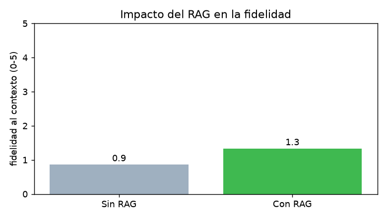

**Figura 14. Latencia promedio por capa.**

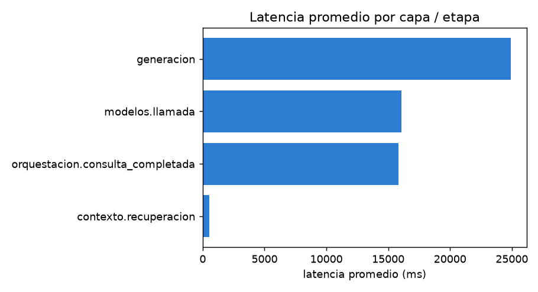

**Análisis de errores.** `[[ANALISIS]]` (se redacta a partir de los casos fallidos del detalle en
`sistema.json`: p. ej., controles con familias cercanas confundidas, o secciones vagas que requieren el
ciclo de agente).

## 11. Limitaciones, riesgos y trabajo futuro

- **Alucinaciones.** El modelo podría proponer una redacción corregida imprecisa; se mitiga anclando cada
  hallazgo a una fuente recuperada (guardrail de fuentes válidas) y mostrando el control citado, pero el
  usuario debe verificar.
- **Corpus en inglés.** La recuperación es translingüe; aunque `bge-m3` la soporta bien, puede perder matices
  frente a un corpus en español. Trabajo futuro: incorporar una traducción o un marco en español.
- **Correspondencia CSF–800-53.** La tabla familia → función es de trabajo, no un crosswalk oficial de NIST;
  sirve para agrupar, no para certificar cumplimiento.
- **Sesgos y cobertura.** El catálogo no agota los controles posibles; un "cubierto" significa alineación con
  el control citado, no cumplimiento integral.
- **Privacidad y seguridad.** Los guardrails anonimizan datos personales y bloquean inyección; aun así, el
  corpus de entrada no debe contener datos sensibles reales sin anonimizar.

## 12. Referencias y anexos

- National Institute of Standards and Technology. *SP 800-53 Rev. 5, Security and Privacy Controls for
  Information Systems and Organizations.* Catálogo OSCAL, repositorio `usnistgov/oscal-content` (dominio
  público, CC0 1.0).
- National Institute of Standards and Technology. *The NIST Cybersecurity Framework (CSF) 2.0*, 2024.
- Anexos: `README.md` (instalación y ejecución) y documentación OpenAPI del servicio (`/docs`).

### Uso de asistentes de IA

En la elaboración del proyecto se usó un asistente de IA para generar y documentar el código y para redactar
borradores de este informe. Las decisiones de arquitectura, la revisión del código, la ejecución de los
experimentos y el análisis de los resultados son responsabilidad de la autora.
